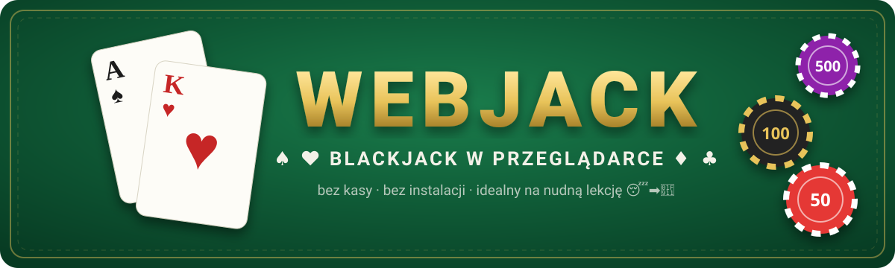
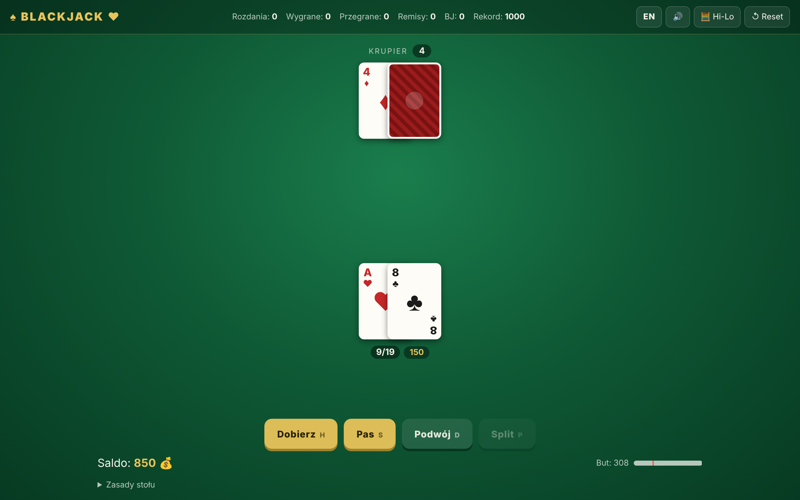
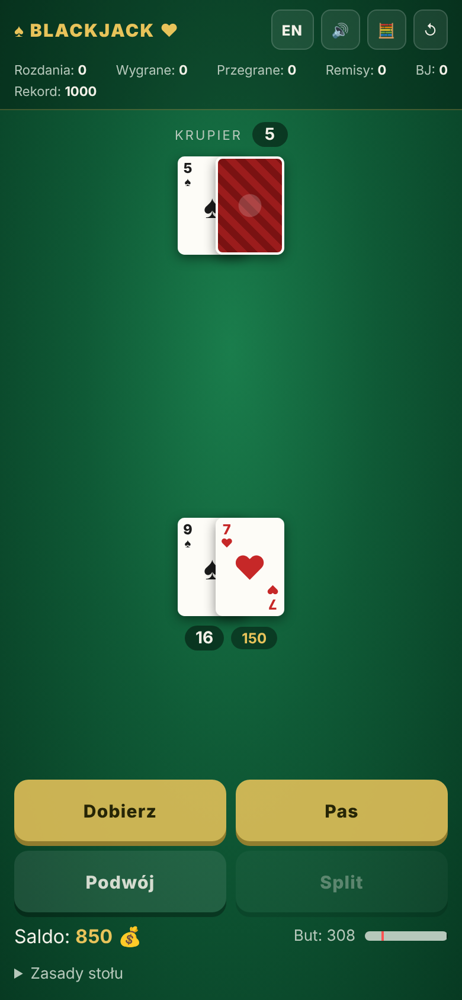

<div align="center">



<br>

[](https://prisma-studios71.github.io/Webjack/)


**Blackjack bez kasy, bez kont, bez instalacji.** Jeden plik HTML, otwierasz w przeglądarce i grasz.
Stworzony z myślą o nudnych lekcjach, przerwach i czekaniu na autobus 🚌

</div>

---

## 🃏 Jak to wygląda

<div align="center">

&nbsp;

</div>

## ✨ Co potrafi

| | |
|---|---|
| 🎴 **Prawdziwy but z 6 talii** | Tasowanie Fisher–Yates na `crypto.getRandomValues`, karta cięcia losowo na 70–80% buta |
| 💰 **Żetony 10 / 50 / 100 / 500** | Startujesz z 1000. Zbankrutujesz? Wujek bank dorzuci kolejne 1000 😅 |
| ✂️ **Split do 4 rąk** | Plus podwojenie na dowolnych dwóch kartach, także po splicie |
| 🛡️ **Ubezpieczenie** | Gdy krupier pokazuje asa, płaci 2:1 |
| 🧮 **Licznik Hi-Lo** | Dla ambitnych, którzy chcą poczuć się jak w *21* |
| 📊 **Statystyki** | Rozdania, wygrane, przegrane, remisy, blackjacki i rekord salda |
| 💾 **Zapis postępu** | Saldo i staty siedzą w `localStorage`, więc nic nie ginie po zamknięciu karty |
| 🔊 **Dźwięki i wibracje** | Z wyciszaniem, żeby nauczyciel się nie zorientował 🤫 |
| 📱 **Mobile first** | Duże przyciski, obsługa notcha, działa jak apka po dodaniu do ekranu głównego |
| 🌍 **PL / EN** | Język wykrywany automatycznie, przełącznik jednym kliknięciem |

## ⌨️ Skróty klawiszowe

| Klawisz | Akcja |
|:---:|---|
| <kbd>H</kbd> | Dobierz (hit) |
| <kbd>S</kbd> | Pas (stand) |
| <kbd>D</kbd> | Podwój (double) |
| <kbd>P</kbd> | Split |
| <kbd>Enter</kbd> | Rozdaj / ten sam zakład |
| <kbd>C</kbd> | Wyczyść zakład |
| <kbd>1</kbd>–<kbd>4</kbd> | Żetony 10 / 50 / 100 / 500 |
| <kbd>Y</kbd> / <kbd>N</kbd> | Ubezpieczenie: tak / nie |

## 📜 Zasady stołu

- Blackjack płaci **3:2**, zwykła wygrana **1:1**, ubezpieczenie **2:1**
- Krupier dobiera do 16 i **pasuje na każdych 17** (także miękkich)
- Krupier **podgląda** zakrytą kartę przy asie lub dziesiątce. Jak ma blackjacka, rozdanie kończy się od razu
- Split asów daje po jednej karcie na rękę, a 21 po splicie to nie blackjack
- Minimalny zakład: **10**

## 🚀 Jak odpalić

**Online:** kliknij przycisk **▶ ZAGRAJ TERAZ** na górze.

**Lokalnie:**

```bash
git clone https://github.com/prisma-studios71/Webjack.git
cd Webjack
# i po prostu otwórz index.html w przeglądarce
```

Serio, to wszystko. Bez `npm install`, bez buildów, bez czekania 🙏

## ⚠️ Disclaimer

To jest **symulacja dla zabawy**. Nie ma tu prawdziwych pieniędzy i nigdy nie będzie.
Kasyno zawsze wygrywa w dłuższej perspektywie, więc lepiej przegrać wirtualne 1000 niż prawdziwe 😉

<div align="center">

---

Zrobione z ♠️♥️♦️♣️ i nudą na lekcjach

</div>
